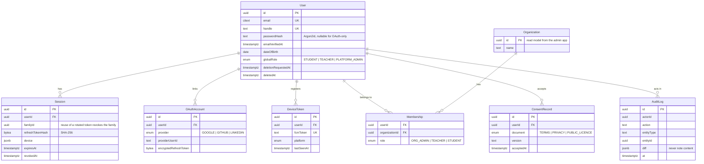
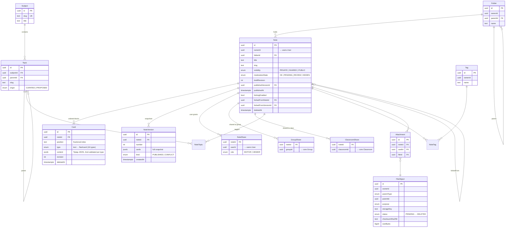
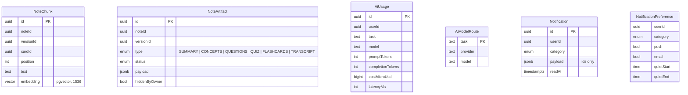

# Entity-relationship diagram

Derived from [section 4](lvn-architecture-v2.md#4-domain-model) and the context ownership in
[section 6.1](lvn-architecture-v2.md#61-bounded-contexts). Owned by lvn-backend; this is the Phase 0 draft for sign-off.

Rules the diagram obeys: every id is UUIDv7; relationships **inside** a context are foreign keys; references
**across** contexts (dashed in the notes below) are plain UUID columns with a local read model, never a foreign key.

## users (schema `users`)

## notes (schema `notes`)

Read models kept by `notes`: `membership_read_model(userId, groupId | classroomId)` for `visibleNotesWhere`.

## core (schema `core`)

```mermaid
erDiagram
  Group ||--o{ GroupMember : ""
  Group ||--o{ GroupPost : ""
  Classroom ||--o{ ClassroomMember : ""
  Quiz ||--o{ Question : ""
  Question ||--o{ Choice : ""
  Quiz ||--o{ QuizAttempt : ""
  QuizAttempt ||--o{ Answer : ""
  FlashcardDeck ||--o{ Flashcard : ""
  Flashcard ||--o{ FlashcardReview : "FSRS state per user"
  Resource ||--o{ ResourceSave : ""
  Resource ||--o{ ResourceRecommendation : ""
  Achievement ||--o{ UserAchievement : ""
  Report ||--o{ ModerationAction : ""

  Group {
    uuid id PK
    text name
    enum privacy "PUBLIC | PRIVATE"
    timestamptz deletedAt
  }
  GroupMember {
    uuid groupId FK
    uuid userId
    enum role "OWNER | ADMIN | MODERATOR | MEMBER"
    timestamptz mutedUntil
  }
  Classroom {
    uuid id PK
    uuid organizationId
    text name
    text joinCode UK
    timestamptz deletedAt
  }
  ClassroomMember {
    uuid classroomId FK
    uuid userId
    enum role "TEACHER | TA | STUDENT"
  }
  Quiz {
    uuid id PK
    uuid ownerId
    uuid classroomId
    uuid sourceNoteVersionId
    timestamptz publishedAt
    timestamptz deletedAt
  }
  QuizAttempt {
    uuid id PK
    uuid quizId FK
    uuid userId
    uuid clientOpId UK
  }
  FlashcardReview {
    uuid flashcardId FK
    uuid userId
    jsonb fsrsState
    timestamptz dueAt
    uuid clientOpId UK
  }
  Exam {
    uuid id PK
    uuid userId
    text name
    date examDate
    uuid_array topicIds
  }
  LearningEvent {
    uuid id PK
    uuid userId
    enum type
    text entityType
    uuid entityId
    int durationMs
    timestamptz serverTs "partition key, monthly"
  }
  Recommendation {
    uuid userId
    enum kind
    uuid entityId
    float score
    text reason
    timestamptz expiresAt
  }
  Resource {
    uuid id PK
    enum type
    text url
    uuid submittedById
    enum status "PENDING | APPROVED | REJECTED"
  }
  Comment {
    uuid id PK
    enum targetType "NOTE | CARD | RESOURCE | GROUP_POST"
    uuid targetId
    uuid authorId
    timestamptz deletedAt
  }
  Report {
    uuid id PK
    text entityType
    uuid entityId
    uuid reporterId
    enum reason
    enum status
  }
  ModerationAction {
    uuid id PK
    uuid reportId FK
    uuid actorId
    enum action "hide | remove | warn | suspend | dismiss"
  }
```

Also in `core`: `Streak`, `PointsLedger`, `Reaction`, `JobStatus` (per context that runs jobs).

## ai (schema `ai`) and communication (schema `comms`)

Shared infrastructure tables, one per schema that needs them: `outbox` (transactional outbox, §9.1) and
`feature_flag` (in `users`, read via GraphQL).
